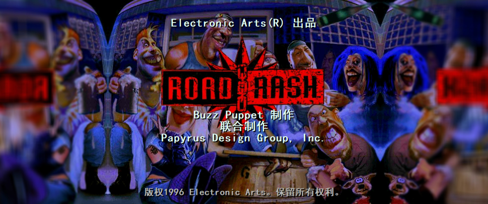

# 暴力摩托：30 周年纪念版 简体中文补丁

适用于 Steam《暴力摩托：30 周年纪念版》英文原版（build **26105967**）。

**分辨率修复补丁请移步：** [RoadRash30th-HD](https://github.com/OBLPlife/RoadRash30th-HD)

## 安装与还原

**安装汉化**

1. 在 Steam 将游戏语言设为**英语**，退出游戏。
2. 从 [Releases 发布页面](https://github.com/OBLPlife/RoadRash30th-Chinese/releases/latest) 下载 `RoadRash_ZH_CN_Setup.exe`，放进游戏根目录（与 `RoadRash95.exe` 在同一文件夹）。
3. **双击 EXE → 点击「安装」**。出现完成提示后，从 Steam 正常启动游戏。

**恢复英文原版**

退出游戏，再次双击 `RoadRash_ZH_CN_Setup.exe`，点击 **「还原」**。

安装器自动备份原文件至游戏目录下的 `中文补丁_原版备份` 文件夹，并在操作完成后显示结果。

如果同时安装了高清补丁，**先安装汉化，再安装高清补丁**；还原时按相反顺序操作。

## 实机截图

| 开场画面 | 游戏模式 |
| :---: | :---: |
|  |  |
| 休息室：存档菜单 | 休息室：模式菜单 |
|  |  |
| 车手资料 | 车手对白 |
|  |  |

## 汉化内容

- **1166 条中文译文**：涵盖游戏菜单、设置、角色对白、车辆与赛道介绍、比赛提示等。
- **中文显示适配**：中文字体、较长文本排版和角色背景图片查找修正。
- 人名、公司名、乐队名及标准按键名称等专有名称保留原文。

## 从源码构建

构建环境：Windows、Python 3.10+、.NET Framework 4.x C# 编译器。使用英文原版游戏目录构建。

```powershell
python build.py --original-dir "D:\Games\RoadRash"
```

如果游戏已经装过汉化，可将 `--original-dir` 指向包含上述两个原版文件的备份目录。

输出为 `dist/RoadRash_ZH_CN_Setup.exe`。安装器通过内嵌差分数据，将本地原版资源转换为汉化文件。

```powershell
python test_installer.py --original-dir "D:\Games\RoadRash"
```

测试覆盖安装、重复安装、还原、版本校验及失败回滚，并生成安装器窗口预览 `build/window.png`。

## 文件

- `Installer.cs`：单文件安装器，自动定位自身所在目录。
- `PatchWindow.cs`：只有安装与还原两个按钮的小窗口。
- `localize.py`：中文字体、内置文字、语言资源和角色背景查找补丁。
- `translations.json`：1166 条替换译文；未改动的字符串从用户原版文件读取。
- `build.py`：校验原版、生成纯汉化差分、编译 EXE。
- `test_installer.py`：安装器文件操作测试。
- `test_window.cs`：安装器窗口测试。

`build/` 和 `dist/` 已在 `.gitignore` 中；正式安装包在 Releases 发布。

## 许可证

本项目采用 [PolyForm Noncommercial License 1.0.0](LICENSE)，允许非商业使用、修改和分发；**禁止未经授权的商业使用及收费倒卖**。
